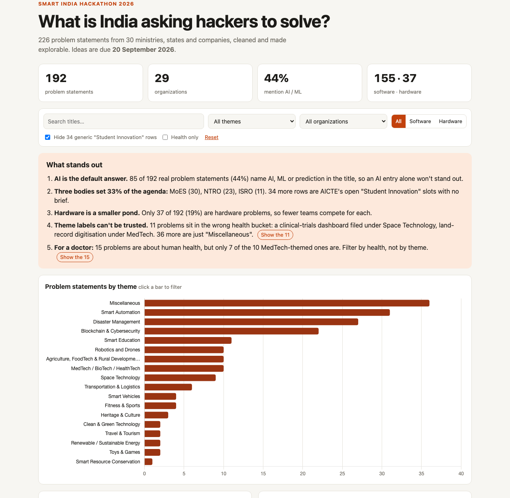

# SIH 2026 Explorer

An interactive dashboard of the **226 Smart India Hackathon 2026 problem statements**.
You can filter them by theme, organization, type and keyword, see where the problems
come from, and find the health problems hidden under the wrong theme labels.



**Who it's for:** students choosing an SIH problem, and the college SIH coordinators who
guide them. The official portal is one long table with unreliable theme labels.

## What it shows

- **Filters:** search, theme, organization and Software/Hardware, plus switches for
  "hide generic Student Innovation rows" and "health only".
- **Charts:** problems by theme (click a bar to filter), top organizations, and the
  technologies named in titles.
- **Insights,** computed from the data:
  - AI or ML appears in 44% of real problem statements.
  - Three bodies (MoES, NTRO and ISRO) set a third of the agenda.
  - Only 19% of the problems are hardware.
  - 11 problems are in the wrong health theme. For example, a clinical-trials dashboard
    is filed under Space Technology, and land-record digitisation is filed under MedTech.
  - 15 problems are about human health, but only 7 of the 10 MedTech-themed ones are.
- **A table of every matching problem,** tagged "health", "theme looks wrong" and by
  technology.

## Data and cleaning

The source is the [SIH 2026 Problem Statements Dataset](https://www.kaggle.com/datasets/riteshmaurya86/sih-2026-problem-statements-dataset)
on Kaggle, compiled from the official SIH 2026 portal. It has 226 rows and 8 columns.

`scripts/prepare.py` turns `data/sih2026.csv` into `data/problems.json`:

- **Organization names:** it merges duplicates (for example, "AICTE" and "All India
  Council for Technical Education (AICTE)") and fixes typos ("Governmcnt of Jharkhand").
- **Titles:** it fixes "Al-Based" to "AI-Based". The source has an OCR-style typo in
  several titles.
- **Dropped columns:** "Submitted Idea(s) Count" and "Deadline" are dropped, because
  every row has the same value (0/500 and 20 September 2026).
- **Added tags, all derived from the title:**
  - `generic`: AICTE's 34 "Student Innovation" placeholder rows.
  - `tech`: technology tags.
  - `health`: the problem is about human health.
  - `mislabel`: the health tag disagrees with the MedTech theme.

Tags are keyword matches, so treat them as a guide. For example, a regex once matched
"mental" inside "environmental"; the word boundary now prevents that.

## Run it

It is a static site with no build step:

```sh
python3 scripts/prepare.py        # only after changing the CSV or the rules
python3 -m http.server 8000       # then open http://localhost:8000
```

Stack: plain HTML, CSS and JavaScript, with [Chart.js](https://www.chartjs.org/) 4.4.1
from cdnjs. It is deployed on Vercel from this repo, and every push to `main`
redeploys it.

## Files

| File | Purpose |
|---|---|
| `index.html`, `style.css`, `app.js` | the dashboard: filters, charts, insights, table; light and dark mode; works on a phone |
| `scripts/prepare.py` | cleaning and tagging (stdlib only) |
| `data/sih2026.csv` | source CSV from Kaggle |
| `data/problems.json` | cleaned data the page loads |
| `docs/screenshot.png` | the README image |

Built as Level 2 of a personal "vibe coding" practice roadmap.
